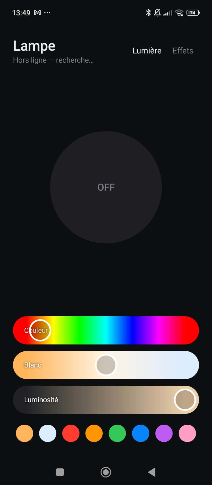
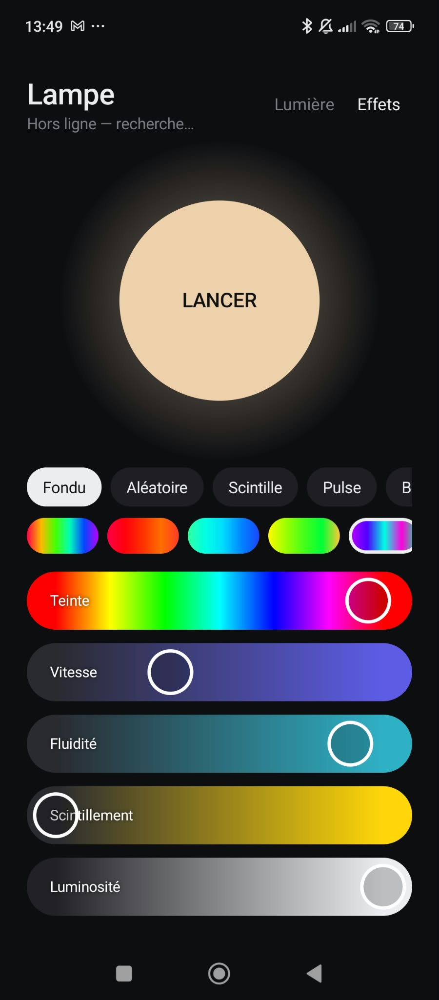

# LampeTuya

Une appli Android minimaliste pour piloter une ampoule connectée **Tuya / Smart Life**
directement en Wi-Fi local : sans cloud, sans compte, sans pub, et instantanée.

<p align="center">
  
  &nbsp;&nbsp;
  
</p>

## Fonctionnalités

**Lumière**
- Gros bouton ON/OFF qui prend la couleur réelle de l'ampoule
- Curseurs couleur, saturation (blanc ↔ couleur pure), blanc (chaud ↔ froid) et luminosité
- 8 pastilles de couleurs rapides

**Effets**
- 5 modes : **Fondu**, **Aléatoire**, **Scintille**, **Pulse** et **Bougie**
- 8 palettes : Arc-en-ciel, Feu, Océan, Forêt, Néon, Couchant, Glace et Bonbon
- Réglages de **teinte** (fait tourner toute la palette), **vitesse**, **fluidité** (des coupures
  sèches aux fondus longs), **scintillement** et **luminosité**
- Animation à 20 images/s, fluide et stable dans la durée

Côté technique : APK d'environ 30 Ko, Java pur, aucune dépendance. L'appli retrouve seule
l'ampoule si sa box lui change d'adresse IP.

## Utiliser avec votre ampoule

Testé sur une ampoule RGB+CCT Tuya (catégorie `dj`, protocole 3.3). La plupart des ampoules
couleur Tuya utilisent les mêmes points de données.

1. **Récupérer l'ID et la clé locale** de l'ampoule. Cette étape est à faire une seule fois :
   il faut un compte développeur gratuit sur [iot.tuya.com](https://iot.tuya.com), lié à
   votre app Tuya ou Smart Life, puis [tinytuya](https://github.com/jasonacox/tinytuya).
   Le détail des étapes est dans [AGENT.md](AGENT.md#récupérer-la-clé-locale).
2. Copier `bulb.properties.example` vers `bulb.properties` et le remplir.
3. Compiler. Il faut un Android SDK (platform 33) et un JDK 17 ou plus.
   ```bash
   echo "sdk.dir=$HOME/Android/Sdk" > local.properties
   ./gradlew assembleRelease
   ```
4. Installer `app/build/outputs/apk/release/app-release.apk` sur le téléphone.

La clé est injectée dans l'APK au moment de la compilation et n'est jamais versionnée :
`bulb.properties` est dans le `.gitignore`.

> L'ampoule n'accepte qu'une connexion locale à la fois. Fermez l'app Tuya ou Smart Life si
> « Lampe » reste « Hors ligne ».

## Comment ça marche

L'appli parle directement le protocole local Tuya : TCP sur le port 6668, chiffré en
AES-128 avec la clé de l'appareil. Les effets ne passent pas par le point de données
habituel de la couleur, dont l'envoi en continu bloque l'ampoule au bout de quelques
dizaines de secondes. Ils utilisent le canal temps réel du mode musique (DP 28), qui n'est
ni enregistré ni remonté au cloud.

Les détails (protocole, mesures, architecture, banc de test) sont dans [AGENT.md](AGENT.md).
